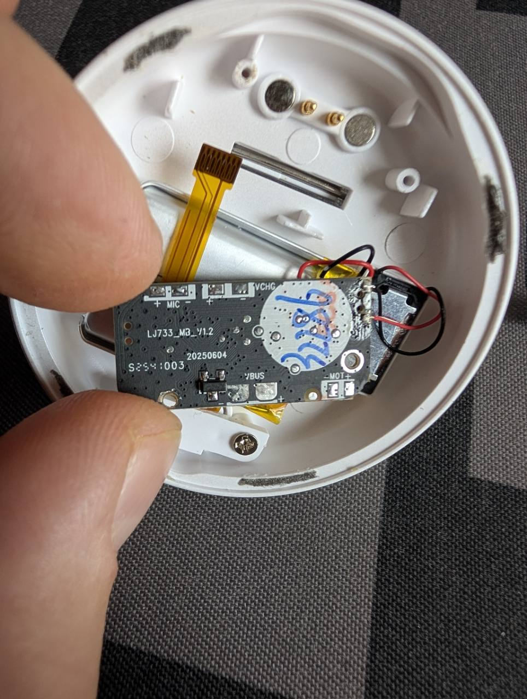
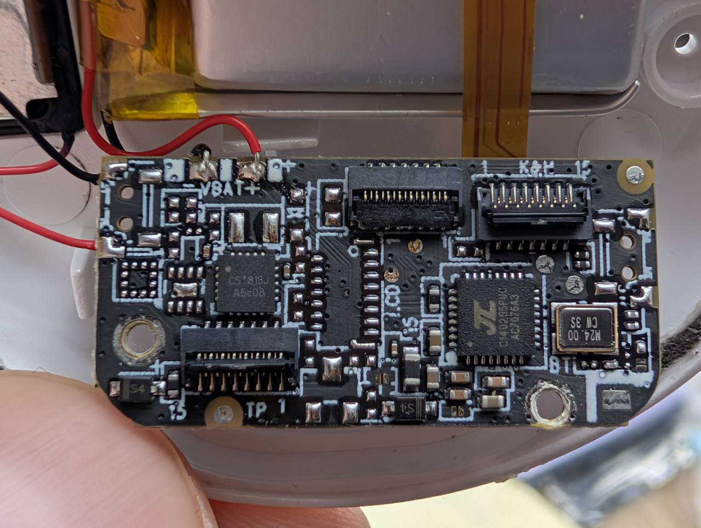
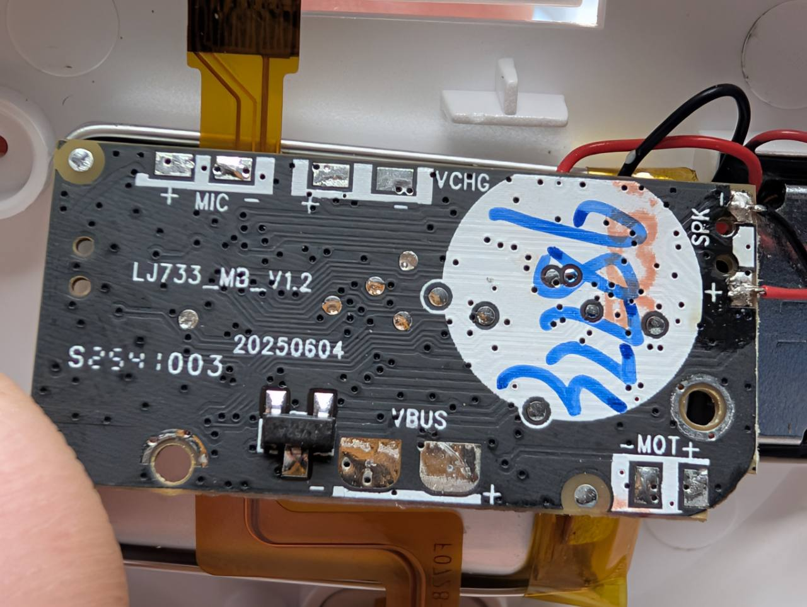

# Recover a SuperBand BJ-1 over Bluetooth

This procedure recovered a BJ-1 that repeatedly showed its splash screen after a custom picture upload. The badge still accepted BLE connections while charging. The successful repair was a reinstall of stock firmware `V32286` using the native JieLi OTA service.

## Identify the badge

Keep the badge on its charger and read the Device Information Service (`180A`) using the web client or a BLE inspector. The unit recovered on Windows reported these values:

| Field | Verified value |
| --- | --- |
| Bluetooth name | `BJ-1` |
| Manufacturer (`2A29`) | `LJ733` |
| Hardware revision (`2A27`) | `LJ733_MB_V1.1` |
| Firmware revision (`2A26`) | `V32286` |
| JieLi OTA service | `AE00`, with `AE01` write and `AE02` notify |

Match the badge and board to the firmware before writing. Related badges such as the DG01 use distinct stock images. [GATT services](protocol/gatt.md) · [Stock firmware variants](protocol/ota-firmware.md)

### Hardware photos

The photographed PCB is marked `LJ733_MB_V1.2` and `20250604`. The hardware revision read over BLE during recovery was `LJ733_MB_V1.1`.







## Try Device Reset

Use **Device Reset** in the SuperBand app, or send `CD 00 02 1D 01` in a single GATT write to `7E400002-B5A3-F393-E0A9-E50E24DCCA9D`. For a manual write, subscribe to `7E400003-B5A3-F393-E0A9-E50E24DCCA9D` first if you want to observe a reply. [Legacy command reference](protocol/legacy-commands.md)

On the recovered unit the write with response timed out. Windows accepted the subsequent write without response, and the badge disconnected 9.73 seconds later without a reset notification. The splash loop persisted on battery after both attempts. Check the screen after reboot to decide whether to proceed to OTA.

## Reinstall stock firmware on Windows

Use the ElectronicCats `qix rcsp-flash` command, which authenticates over `AE00` and can follow the loader across its BLE address change. Keep the badge connected to the charger throughout the transfer. [ElectronicCats native RCSP updater](https://github.com/ElectronicCats/jieli-ble-badge-research/blob/1802a8860d87f02c4c8562721f49ee85f1031dce/tools/qix-ble/README.md#flash--ota)

1. Install the revision of the updater used for the verified recovery in a Python 3.10+ virtual environment.

   ```powershell
   git clone https://github.com/ElectronicCats/jieli-ble-badge-research.git
   git -C .\jieli-ble-badge-research checkout 1802a8860d87f02c4c8562721f49ee85f1031dce
   python -m venv .\bj1-recovery-venv
   & .\bj1-recovery-venv\Scripts\python.exe -m pip install .\jieli-ble-badge-research\tools\qix-ble
   $qix = ".\bj1-recovery-venv\Scripts\qix.exe"
   & $qix scan --all --timeout 15
   ```

2. Download the [BJ-1 stock ZIP](https://res.jusonsmart.com/0ta/LJ733/V32286_A12091701_LJ733_V1.2_ZX400_BJ-1_SUPERBAND.zip) and extract `app.ufw`. The package's app binary contains both `V32286` and `LJ733_MB_V1.1`, matching the live device information. The `V1.2` text is part of the archive name.

   | File | SHA-256 |
   | --- | --- |
   | Stock ZIP | `ec0785f8264bab9ff578e87ac8a16bd47c8c514bdaa756bad64c6f139c5320c2` |
   | `app.ufw` (3,863,072 bytes) | `43c1108274737f1a00f415fc86a5bb75cd5817a79cc912a065f08cff9d690466` |

3. Set the BLE address to your BJ-1's address and run the OTA preflight with the extracted file. Proceed only if the result shows `"accepted": true`. The verified unit authenticated and returned `E2 = 0x00` with a zero-length file-info block. That response establishes OTA eligibility. Payload verification happens during the flash.

   ```powershell
   $badgeAddress = "AA:BB:CC:DD:EE:FF"
   Get-FileHash .\app.ufw -Algorithm SHA256
   & $qix rcsp-flash $badgeAddress .\app.ufw --probe-only --json
   ```

4. Start the firmware transfer.

   ```powershell
   & $qix rcsp-flash $badgeAddress .\app.ufw --timeout 12
   ```

   The recovered unit reported `E6 = 0x80` on pass 1, disconnected, and re-advertised as a loader at a different BLE address. The updater followed it automatically. Wait for pass 2 to report `E6 = 0x00` and for the badge to reboot. That final status means the badge verified and applied the image. Leave the charger attached during the loader transition.

5. Check that the badge reappears at its original BLE address. Then unplug the charger and boot it on battery. The verified unit reported the same `V32286` revision after reboot and reached its normal screen. The screen check confirms recovery because a same-version reinstall leaves the reported version unchanged.
